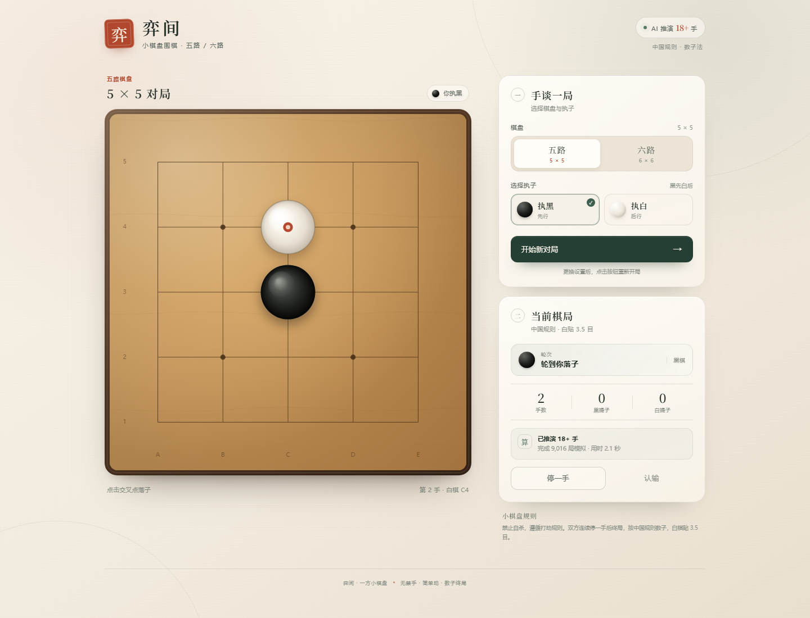

# 弈间 · 小棋盘围棋

一个无需安装、打开即玩的网页围棋。支持 **5 × 5** 与 **6 × 6** 棋盘，玩家可以选择执黑或执白，由启发式蒙特卡洛树搜索（MCTS）AI 担任对手。



## 运行

直接双击 `index.html` 即可游玩。页面为纯静态 HTML/CSS/JavaScript，不依赖任何第三方库，也不需构建。

更推荐用本地 HTTP 服务打开，这样 AI 会在 Web Worker 中计算，思考时界面仍保持流畅：

```powershell
cd weiqi
python -m http.server 8000
```

然后访问 `http://localhost:8000/`。若直接以 `file://` 打开，浏览器会限制 Worker，页面会自动降级到主线程计算，功能不受影响；此时复盘分析期间界面可能会短暂停顿。

## 功能

- 5 × 5 / 6 × 6 两种棋盘，可随时开始新对局。
- 玩家可选择执黑先行，或执白后行（AI 执黑时会自动开局）。
- 点击交叉点落子，支持悬停预览、落子动画、最后一手标记。
- 停一手、认输、终局数子与结果面板。
- 提子、禁自杀、简单劫规则。
- 中国规则数子，白棋贴 3.5 目；双方连续停一手后终局。
- **复盘**：对局结束后，逐手给出双方落子前的全盘胜率、每个合法点的胜率前三与实战排名，并用折线图展示每手之后的黑棋实时胜率。
- 最近 8 局会自动保留在本次会话中，可从复盘面板或“复盘历史对局”按钮切换查看。
- AI 会把“停一手”作为候选着法参与搜索，在终局或形势领先时主动停一手。
- 响应式布局，桌面与手机均可使用。

## 复盘

一局结束后点击结果面板中的“复盘本局”，或使用侧栏的“复盘历史对局”按钮：

- 每个局面都会评估棋盘上所有合法点（包括停一手），每个点固定做 `REVIEW_PLAYOUTS = 20` 次随机推演。
- 表格列出每一手的实战胜率（行棋方视角）、该手之前的推荐前三、以及实战着法在全部候选中的排名。
- 折线图展示每手之后的黑棋实时胜率；点击折线节点或表格行，可在左上角的小棋盘上查看当时的局面、推荐点（编号 1 / 2 / 3）与实战落点（红色虚线圈）。
- 复盘分析运行在独立的 Web Worker 中，不会阻塞当前对局；分析进度会实时显示。
- 推演次数可在 `app.js` 顶部的 `REVIEW_PLAYOUTS` 调整，数值越大结果越稳定、耗时越长。

## AI 设计

AI 位于 `ai.js`，使用带启发式的 MCTS/UCT 搜索：

- 每个模拟分支会持续落子并推演到终局，而不是只做一层静态判断。
- 单次推演至少读取 **18 手**（`MIN_LOOKAHEAD_PLIES = 18`），通常会长于 18 手；若棋局已自然结束则提前终止。
- 默认每步思考约 2.1 秒；HTTP 模式下运行于 `ai-worker.js`，不阻塞界面。直接打开本地文件时使用约 1.65 秒的主线程降级模式。
- 树搜索在 AI 回合取最大胜率、在对手回合取最小胜率，避免对手“配合”AI 走棋。
- 停一手始终是一个候选着法：对手刚停一手且当前数子领先时直接终局；其余情况交给搜索判断，早期不会被轻易选中。
- 推演策略会优先考虑提子、救棋、打吃，避开自填眼、自杀和明显的坏形。
- 终局使用中国规则数子，比较黑白双方盘面加贴目后的胜负。

搜索时间、贴目、复盘推演次数等参数可在 `app.js` 与 `ai.js` 顶部的常量中调整。

## 关于 GPU 加速

结论：**当前规模下不建议使用 GPU，暂未接入 WebGPU/WebGL 计算。**

原因：

1. 棋盘只有 5 × 5 或 6 × 6，单次推演的计算量很小；MCTS 是高度分支化、逐手依赖的控制流，GPU 擅长的宽向量并行在这里收益有限。
2. 每次扩展/模拟都需要读写棋盘、提子与气，规则判断包含大量分支；在着色器中实现完整围棋规则（提子、劫、眼、数子）复杂且容易出错，CPU 上几行代码的逻辑在 GPU 上会变成大段分支代码。
3. WebGPU 的调度、数据上传/回读开销通常大于一个小棋盘单次推演本身；把每个节点都提交一次 GPU dispatch 反而更慢。
4. 当前 CPU 单线程大约每秒可完成数千次推演；复盘一局通常只需数秒，而且已经放在独立 Worker 中执行。

更划算的加速方向是：增加 Web Worker 数量并行分析多个局面、使用 WebAssembly 优化热点，或在棋盘扩大（如 19 路）或引入神经网络策略/价值网络后再考虑 GPU 批量推理。若未来确实需要 GPU，优先考虑“批量并行推演”而不是逐节点 MCTS。


## 文件结构

```text
weiqi/
├── index.html      页面结构
├── styles.css      视觉样式与响应式布局
├── engine.js       围棋规则、提子、劫、数子
├── ai.js           MCTS 搜索、停一手与复盘逐点分析
├── ai-worker.js    AI / 复盘 Web Worker 入口
├── app.js          界面交互、棋盘绘制、对局流程与复盘面板
├── preview.png     页面预览图
└── README.md
```

## 说明

- 终局按当前盘面直接数子，不包含手动标记死子的流程；小棋盘上正常对局一般会在提子结束后进入终局。
- 若想更深入调整 AI 强度，可增大 `app.js` 中的 `AI_TIME_LIMIT`，或调整 `ai.js` 中的 `MIN_LOOKAHEAD_PLIES`、`UCT_EXPLORATION`。
